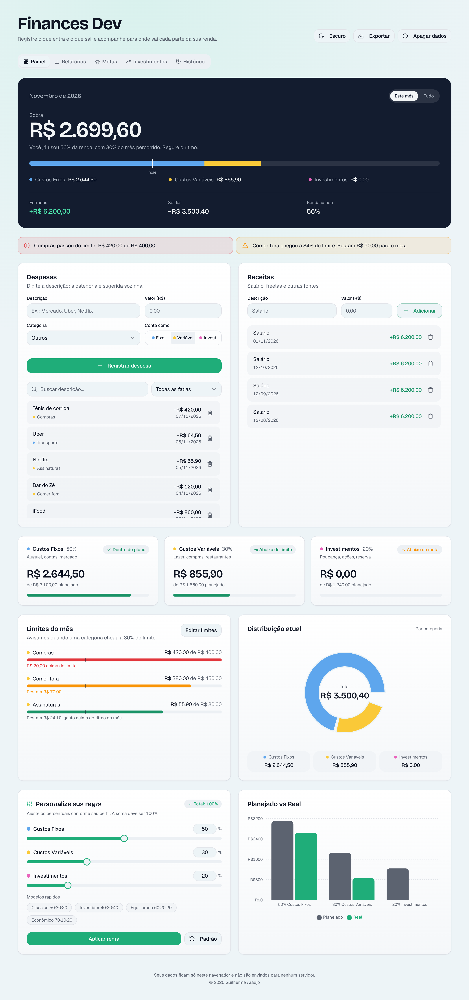
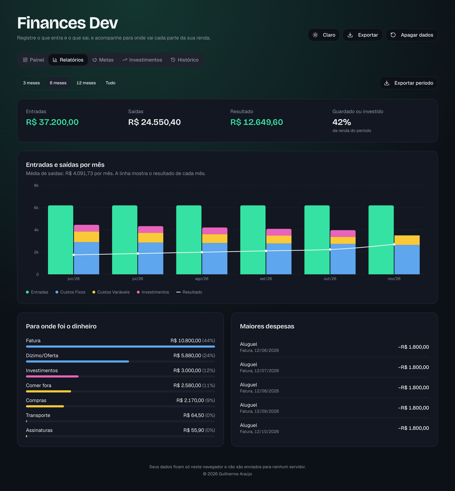
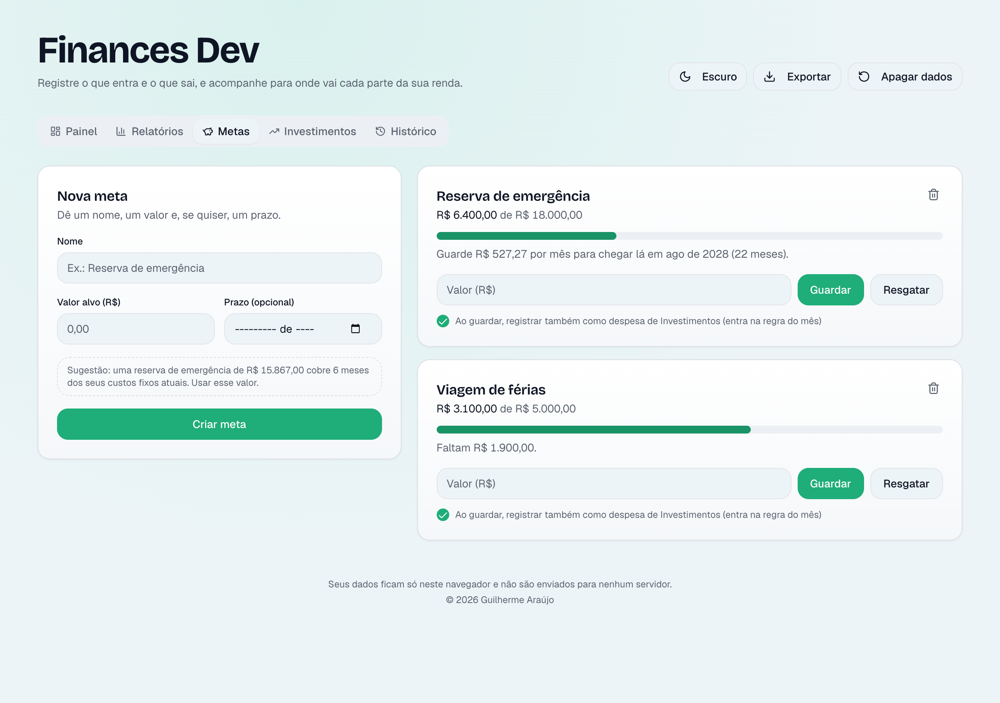
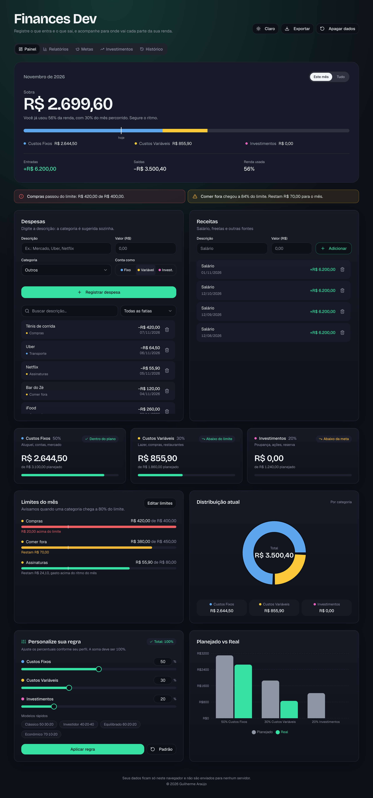

<div align="center">

# 💰 Finances Dev

### Seu dinheiro, sem mistério.

Registre o que entra e o que sai e descubra, de um jeito simples,<br/>
**quanto sobra no mês** e **para onde cada real está indo**. 🧭


[✨ Funcionalidades](#-o-que-ele-faz-por-você) •
[📸 Telas](#-por-dentro-do-app) •
[🚀 Rodando](#-rodando-na-sua-máquina) •
[🔒 Privacidade](#-seus-dados-são-só-seus) •
[🗺️ Próximos passos](#️-próximos-passos)

</div>

---

<p align="center">
  
</p>

---

## 👋 Pra que serve?

Sabe aquela sensação de chegar no fim do mês e não saber para onde foi o salário? O **Finances Dev** nasceu para acabar com ela.

Você anota seus gastos em poucos segundos e o app faz o resto: separa tudo em categorias, compara com o seu planejamento e **avisa antes** de você estourar o orçamento. 🚨

> [!TIP]
> O app usa por padrão a regra **50 · 30 · 20**: 50% da renda para custos fixos, 30% para custos variáveis e 20% para investir. Não combina com você? Dá para ajustar os percentuais como quiser. 🎛️

---

## ✨ O que ele faz por você

<table>
<tr>
<td width="50%" valign="top">

### ✍️ Registrar sem esforço
- 💸 Receitas e despesas em segundos
- 🪄 **Categoria automática:** digite "Uber" e ele já sabe que é Transporte
- 🧠 **Aprende com você:** corrigiu uma vez, ele lembra da próxima
- ↩️ Apagou sem querer? Tem **desfazer**

</td>
<td width="50%" valign="top">

### 📅 Acompanhar o mês
- 💵 Quanto **sobra** agora, em destaque
- 📍 Marcador de **"hoje"** para saber se você está gastando rápido demais
- 🎯 **Limites por categoria** (ex.: R$ 400 em Compras)
- ⚠️ Alerta aos **80%** e quando o limite **estoura**

</td>
</tr>
<tr>
<td width="50%" valign="top">

### 📊 Entender os números
- 📈 Relatórios de **3, 6 ou 12 meses**
- 🔍 **Para onde foi o dinheiro**, categoria por categoria
- 🏆 As **maiores despesas** do período
- 📤 Exporta **CSV** que abre direto no Excel

</td>
<td width="50%" valign="top">

### 🐷 Planejar o futuro
- 🎯 **Metas de economia** com barra de progresso
- 🧮 Quanto guardar **por mês** para chegar no prazo
- 🛟 Sugestão de **reserva de emergência**
- 📈 **Simulador** de investimentos com juros compostos

</td>
</tr>
</table>

E ainda tem 🌗 **tema claro e escuro** e 📱 **layout pensado para o celular**.

---

## 📸 Por dentro do app

### 📊 Relatórios
Entradas e saídas mês a mês, com as saídas divididas por tipo de gasto e uma linha mostrando o resultado de cada mês.

<p align="center">
  
</p>

### 🐷 Metas
Defina um objetivo e o app calcula quanto você precisa guardar por mês para chegar lá.

<p align="center">
  
</p>

<details>
<summary><b>🌙 Ver o painel no tema escuro</b></summary>
<br/>
<p align="center">
  
</p>
</details>

<details>
<summary><b>📱 Ver no celular</b></summary>
<br/>
<p align="center">
  
</p>
</details>

---

## 🚀 Rodando na sua máquina

> [!NOTE]
> Você vai precisar do **Node.js 18 ou superior**.

```bash
# 1. Clone o repositório
git clone https://github.com/guiaraujoo/finances_dev.git
cd finances_dev

# 2. Instale as dependências
npm install

# 3. Suba o servidor de desenvolvimento
npm run dev
```

Pronto! Abra **http://localhost:8080** e comece a usar. 🎉

<details>
<summary><b>🛠️ Todos os comandos</b></summary>
<br/>

| Comando | O que faz |
| :--- | :--- |
| `npm run dev` | 🔥 Servidor de desenvolvimento |
| `npm run build` | 📦 Build de produção em `dist/` |
| `npm run preview` | 👀 Serve o build localmente |
| `npm test` | ✅ Roda os testes (Vitest) |
| `npm run lint` | 🧹 Verifica o código com ESLint |

</details>

---

## 🧰 Feito com

| | Tecnologia | Para quê |
| :---: | :--- | :--- |
| ⚛️ | **React 18 + TypeScript** | Interface e tipagem |
| ⚡ | **Vite** | Build e servidor de desenvolvimento |
| 🎨 | **Tailwind CSS + shadcn/ui** | Estilo e componentes acessíveis |
| 📊 | **Recharts** | Gráficos |
| 🛡️ | **Zod** | Validação dos dados salvos |
| 🧪 | **Vitest** | Testes |
| ▲ | **Vercel** | Hospedagem |

<details>
<summary><b>📂 Como o código está organizado</b></summary>
<br/>

```
src/
├── pages/Index.tsx            🏠 Página principal e abas
├── hooks/useFinance.ts        🔄 Estado da aplicação e persistência
├── lib/                       🧠 Regras de negócio, sem React
│   ├── finance.ts             Tipos, categorias, formatação e validação
│   ├── categorize.ts          Categorização automática
│   ├── budget.ts              Limites e alertas
│   ├── reports.ts             Cálculos dos relatórios
│   ├── goals.ts               Metas de economia
│   ├── history.ts             Resumos mensais
│   ├── export.ts              Geração de CSV
│   └── storage.ts             Leitura, validação e gravação no navegador
├── components/finance/        🧩 Componentes de tela
└── test/                      ✅ Testes
```

💡 As regras de cálculo ficam em `src/lib` e os componentes só exibem os resultados. Quer mudar quando o alerta dispara? É só mexer em `budget.ts`, sem tocar na interface.

</details>

---

## 🔒 Seus dados são só seus

Sem cadastro, sem servidor, sem rastreamento. Tudo fica **no seu navegador**. 🏡

- 💾 Os dados ficam salvos no `localStorage`, na chave `finance-data-v1`
- 🧹 Dados corrompidos são descartados um a um, sem perder o resto
- 🪟 Com o app aberto em duas abas, uma não apaga o que a outra salvou
- 🧾 O CSV exportado é protegido contra injeção de fórmulas em planilhas
- 🛡️ Em produção, uma política de segurança (CSP) bloqueia scripts externos e o envio de dados para outros sites

> [!WARNING]
> Os dados **não são criptografados** e somem se você limpar os dados do site no navegador. Use o botão **Exportar** de vez em quando para guardar uma cópia. 📤

---

## 🗺️ Próximos passos

- [x] Categorização automática
- [x] Limites por categoria com alertas
- [x] Relatórios por período
- [x] Metas de economia
- [x] Exportação em CSV
- [ ] ✏️ Editar um lançamento já registrado
- [ ] 🔁 Lançamentos recorrentes (aluguel, assinaturas)
- [ ] 🏦 Importar extrato bancário (OFX/CSV)
- [ ] 🔐 Proteger os dados com senha
- [ ] ⚡ Carregar as abas sob demanda para o app abrir mais rápido

---

<div align="center">

### 👨‍💻 Autor

Feito com 💚 por **Guilherme Araújo**

📄 Projeto de uso pessoal

⭐ Curtiu? Deixa uma estrela no repositório!

</div>
